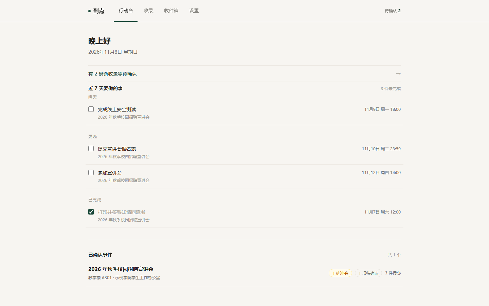
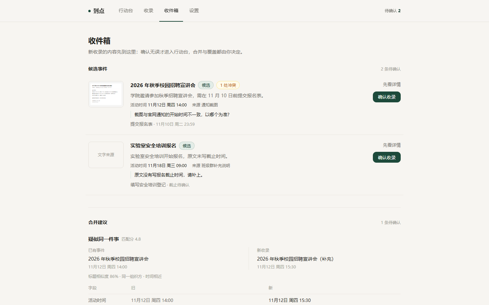
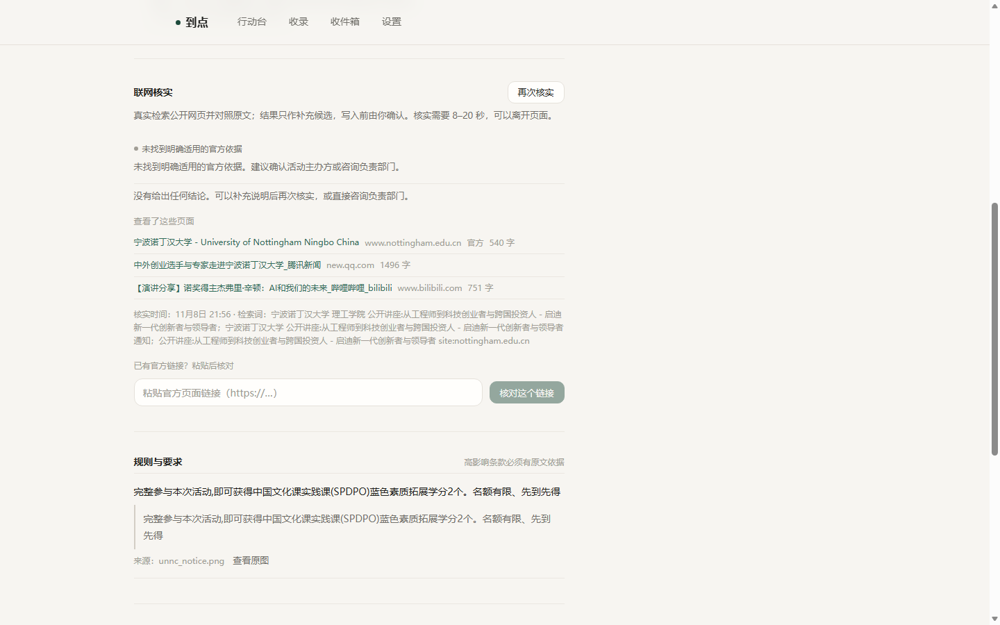

# 到点 ontime

把散落在**官网通知、邮件、群聊截图**里的校园信息，收成一份**字段有出处、冲突要你裁决、核实不到就不下结论**的行动清单。

> 这是一个可直接运行的 Demo：截图识别、跨来源合并、联网核实都是真实模型调用与真实网页抓取，没有预置的"识别结果"。模型 Key、邮箱凭证、原始素材与数据库均不入库。

<p align="center">
  
  
  
</p>

<p align="center"><sub>真实运行截图，从左到右：行动台（只列近 7 天要做的事）· 收件箱（候选、逐字段冲突、合并建议）· 联网核实（检索不到官方依据时明说「未找到明确适用的官方依据」）</sub></p>

## 三条不可让渡的原则

1. **字段级溯源** — 标题、时间、地点、材料、规则各自指向自己的来源与原文片段，点开就能看到截图里那一行。
2. **不静默覆盖** — 同一字段出现第二个值时并列展示，由用户选择；合并与更新都可撤销，历史只追加。
3. **未确认就说未确认** — 找不到依据时只写「未找到明确适用的官方依据」，不给结论、不编造规则。

## 能力清单

### 真实可用（已实机验证）

| 能力 | 说明 | 验证方式 |
| --- | --- | --- |
| 截图 / 粘贴 / 纯文本收录 | 视觉模型真实转录，再抽成事件与任务；字段带原文 `quote` | `fixtures/demo/unnc_notice.png` 实跑 |
| 事件与任务分离 | 活动时间（事件）与报名截止（任务）是不同实体 | 详情页两行并列 |
| 字段级来源 | 每个 claim 可展开原文与来源缩略图 | 事件详情 → 字段行 |
| 跨来源合并建议 | 第二份信息（群聊/邮件/官网）命中同一事件时给 diff，由用户接受或拒绝 | 收录 `unnc_chat.png` |
| 冲突并存 | 同字段多值标 `conflict`，不自动覆盖，选一个后保留另一种说法 | 地点冲突两候选 |
| 联网核实（搜索） | 真实检索 + 抓原文 + 适用性判断，结果含 `not_found` | 详情页「联网核实」 |
| 按链接核实 | 粘贴官方链接逐字段核对，写入前由用户确认 | `POST /api/verify/url` |
| 官网同步与变更检测 | 对 UNNC 三栏目真实抓取；正文变化 → `stale` + change 记录 | 设置页「关注的栏目」 |
| 邮件 `.eml` / `.mbox` 导入 | 真实解析，重复导入返回 409 | 设置页「导入邮件」 |
| 邮箱 IMAP 只读连接 | 2026-11-09 用 163.com 测试账号真实登录并同步 3 封；`Message-ID` 去重，`BODY.PEEK` 不标已读 | 设置页「邮箱」 |
| 自定义站点（声明式） | 核实查询自动附加 `site:` 限定 | 设置页「自定义站点」 |
| 站点调研 Agent | 受限 `opencode` 子进程调研公开列表页，返回条目与解析规则 | 设置页「添加站点 → 调研」 |
| 站内提醒 | 按任务截止前 2 小时生成，浏览器通知 | 行动台提醒区 |
| 日历导出 | `.ics`，`DTEND` 取 `end_at` | 事件详情「导出日历」 |
| 能力矩阵接口 | 页面徽标与答辩口径同源 | `GET /api/capabilities` |

### 已实现但未验证

| 能力 | 现状 |
| --- | --- |
| 第三方 API 源 | JSON 拉取与字段抽取链路已实现，仅在本地 mock 上跑通；没有真实第三方 Key，能力表标 `unverified`，不宣称可用 |

### 规划 / 仅入口

| 能力 | 现状 |
| --- | --- |
| 多渠道推送与后台提醒 | 设置页只有「演示暂未接入」入口，不显示假的连接状态或同步时间 |
| 多用户、登录、多租户 | 未做；当前是单 profile、单用户 |

## 本地启动

需要 Python 3.12+、[uv](https://docs.astral.sh/uv/)、Node 22+。以下命令在 Windows PowerShell 下验证过。

```powershell
# 1) 后端
cd backend
uv sync
Copy-Item .env.example .env          # 按需改 SCHOOL_NAME / SCHOOL_DOMAIN
uv run uvicorn app.main:app --reload --port 8000

# 2) 前端（另开一个终端）
cd frontend
npm install
npm run dev                          # http://127.0.0.1:5173
```

- 前端开发服务器把 `/api`、`/media` 代理到 `http://127.0.0.1:8000`，两边都起来就能用。
- **模型 Key 不在仓库**：设置环境变量 `LLM_API_KEY`，或写入 `~/.ontime/llm_key`。没有 Key 时收录会如实失败（`source.status=failed`），不会返回假结果。
- 可选凭证也都放在仓库外：IMAP 在 `~/.ontime/imap.json`，第三方站点在 `~/.ontime/sites.json`。
- 数据库是 SQLite（`backend/ontime.db`，已忽略），建表靠 `create_all`；随时可用设置页「重置演示数据」或 `POST /api/demo/reset` 复位。
- 想立刻看到效果：重置后收录 `fixtures/demo/unnc_notice.png`，再收录 `fixtures/demo/unnc_chat.png` 触发合并与冲突。

## 目录结构

```
backend/        FastAPI + SQLAlchemy + SQLite
  app/api.py          路由；claims.py 是语义字段唯一写入口
  app/pipeline.py     收录流水线；verify.py 核实；services/ 官网同步与站点 Agent
frontend/       Vite + React 19 + TypeScript（无 Tailwind，样式集中在 src/styles.css）
  src/api.ts          唯一的请求封装；src/pages/* 五个页面
fixtures/       demo 素材：UNNC 公开通知与群聊截图、对应文本、生成脚本
slides/         HTML 演示稿、页面截图（本 README 配图来源）、导出的 PDF
video/          Remotion 宣传片工程、字幕、编码脚本；成片不入库（见 video/README.md）
docs/           API 契约、技术方案、策划文档、能力口径、调度台账
deliverables/   720p 预览片（见下）
```

## 演示视频与 PPT

- **PPT**：`slides/out/ontime-deck.pdf`（10 页，16:9），源文件是 `slides/slides.html`，用 Edge 无头打印即可重出。
- **宣传片**：成片 1080p / 30fps / 122.7s，交付母版约 **149 MB，超过 GitHub 单文件 100 MB 上限，不入库**；工程、脚本、字幕都在 `video/`，本地按 [`video/README.md`](video/README.md) 重新渲染。
- **仓库内预览**：`deliverables/preview-720p.mp4`（1280×720 / 17.4 MB / H.264 + AAC / bt709 & limited range），从同一母版转码，用于快速预览画面与配音。

## 素材与许可

- `fixtures/demo/` 内是自绘截图与自拟文本，学校信息取自 UNNC 公开通知；不含真实私聊、真实邮箱或任何凭证。"启澜大学"等为虚构机构。
- 宣传片 BGM：**"Continue Life" — Kevin MacLeod (incompetech.com)，CC BY 4.0**，片尾保留署名。许可与来源明细见 [`video/assets/README.md`](video/assets/README.md)。
- 备选 BGM "Dim The Lights"（Ahjay Stelino）与两个 whoosh 音效来自 Mixkit 免费许可；音效不要求署名，仓库内一并注明。
- 上述音频文件（约 5.5 MB）随工程入库，便于直接渲染；其余下载原件与中间产物不入库。

## 已知限制

Demo 阶段接受的技术边界与残余风险统一记录在 [issue #1](https://github.com/admin-init/ontime/issues/1)，不在此重复。

## 文档

- [`docs/API契约_v1.md`](docs/API契约_v1.md)（增量见 `v1.1` / `v1.2`）— 前后端唯一接口依据
- [`docs/技术方案_v0.2_最小原型.md`](docs/技术方案_v0.2_最小原型.md) — 选型、数据模型、流水线、风险
- [`docs/到点_项目策划文档_v0.1_2026-11-08.md`](docs/到点_项目策划文档_v0.1_2026-11-08.md) — 定位、场景、MVP 与验收
- [`HANDOFF.md`](HANDOFF.md) — 最新状态、证据与下一步；[`AGENTS.md`](AGENTS.md) — 执行约定

## 许可

本项目代码采用 **BSD 3-Clause License**，全文见 [`LICENSE`](LICENSE)。
版权行：`Copyright (c) 2026 到点 Contributors`。

**不在此协议范围内**：

- `fixtures/demo/` 中引用的第三方通知内容（如宁波诺丁汉大学公开活动页）版权归原站点，仅用于演示；
- BGM 与音效按各自许可使用（CC BY 4.0 / Mixkit），详见上文「素材与许可」；
- 「到点」名称与标识不随代码授权；衍生项目不得暗示官方背书（BSD-3 第 3 条）。
